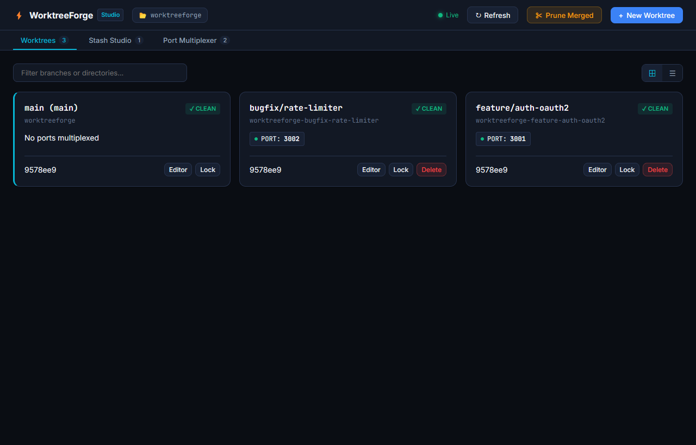
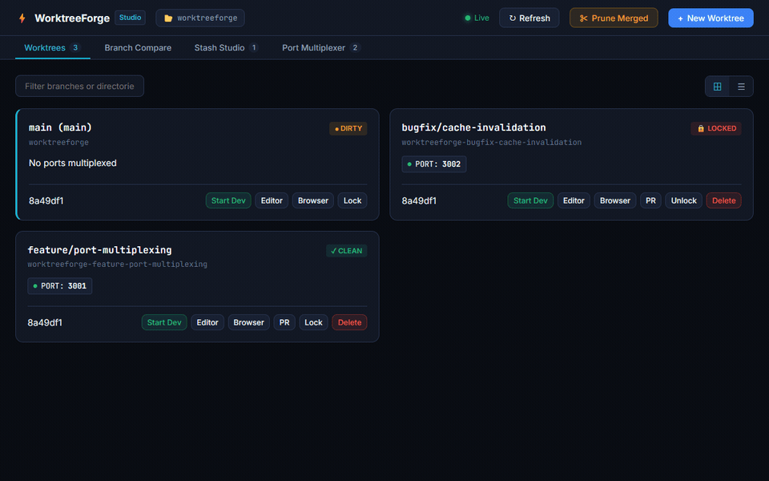

# WorktreeForge

<p align="center">
  <strong>High-speed Git worktree supervisor, interactive stash studio, and local dev server port multiplexer with merged PR auto cleanup.</strong>
</p>

<p align="center">
  
</p>

<p align="center">
  <a href="https://github.com/alexandrmotologa/worktreeforge/actions"></a>
  <a href="LICENSE"></a>
  <a href="https://www.python.org/"></a>
  <a href="https://github.com/alexandrmotologa/worktreeforge/stargazers"></a>
</p>

---

## Demo

<p align="center">
  
</p>

---

## What WorktreeForge solves

Git worktrees let you checkout multiple branches into isolated folders at the same time. While this avoids constant branch switching and preserves build caches, day-to-day worktree usage introduces four friction points:

1. **Port collisions**: Running dev servers in multiple worktrees causes `EADDRINUSE: port 3000 already in use` errors.
2. **Manual bookkeeping**: Setting up a worktree requires multi-step Git commands and manual directory management.
3. **Forgotten stashes**: `git stash` entries are hidden in a linear stack where context gets lost.
4. **Orphaned folders**: Once pull requests are merged, local worktree directories remain on disk, consuming storage and cluttering `.git/worktrees`.

WorktreeForge automates worktree creation, assigns non-conflicting port offsets into `.env.local` files, surfaces an interactive diff viewer for stashes, and provides one-command cleanup for merged GitHub pull requests.

---

## Key capabilities

- **Deterministic port multiplexing**: Scans `.env`, `.env.example`, and `package.json` for declared ports (such as `PORT`, `VITE_PORT`, `SERVER_PORT`) and generates `.env.local` files with incremented offsets (Base: 3000, Worktree 1: 3001, Worktree 2: 3002).
- **Socket availability verification**: Tests each assigned port via non-blocking TCP socket binding before saving the configuration.
- **Git worktree supervisor**: Creates, lists, locks, and removes worktree directories with porcelain output parsing and dirty-state safety checks.
- **Visual Stash Studio**: Displays git stashes with file lists, unified diffs, search across changes, and direct apply or drop actions.
- **GitHub PR status detection**: Queries `gh pr view` to mark worktrees whose PRs are already merged, closed, or open.
- **Safe auto-pruning**: Removes merged worktrees and clears orphaned Git references while safeguarding uncommitted changes.
- **Terminal UI and Web Studio**: Includes both a keyboard-driven Textual terminal dashboard and a FastAPI web interface with live updates.

---

## Architecture

```
+-----------------------------------------------------------------------------------+
|                                  WORKTREEFORGE                                    |
+-----------------------------------------+-----------------------------------------+
                                          |
        +---------------------------------+---------------------------------+
        |                                                                   |
+-------v-------------------------+                 +-----------------------v-------+
|    Worktree Lifecycle Manager   |                 |    Local Port Multiplexer     |
|  * Fast Multi-Branch Checkout   |                 |  * .env Auto-Configuration    |
|  * Directory Isolation          |                 |  * Dynamic Port Offsets       |
|  * Submodule & Dependency Link  |                 |  * Prevents EADDRINUSE Conflicts|
+-------+-------------------------+                 +-----------------------+-------+
        |                                                                   |
        +---------------------------------+---------------------------------+
                                          |
                        +-----------------v-----------------+
                        |       Visual Stash Studio         |
                        |  * Searchable Stash Hierarchy     |
                        |  * Hunk-Level Diff Viewer         |
                        |  * 1-Click Selective Pop / Apply  |
                        +-----------------+-----------------+
                                          |
                        +-----------------v-----------------+
                        |    GitHub PR Sync & Auto-Prune    |
                        |  * Merged PR Detection via gh     |
                        |  * Safe Unlink & Disk Reclamation |
                        |  * Interactive TUI & Web UI       |
                        +-----------------------------------+
```

---

## Installation

### Prerequisites

- Python 3.10 or higher
- Git 2.30 or higher
- Optional: GitHub CLI (`gh`) for PR status synchronization

### Install from source

```bash
git clone https://github.com/alexandrmotologa/worktreeforge.git
cd worktreeforge
python -m venv .venv
source .venv/bin/activate  # On Windows: .venv\Scripts\activate
pip install -e .
```

---

## Quick start

### 1. Initialize inside a Git repository

Run WorktreeForge inside any repository to inspect existing worktrees:

```bash
worktreeforge list
```

### 2. Create a new worktree with port multiplexing

Create a worktree for a new branch named `feature/payments`. WorktreeForge creates the directory `../repo-payments`, checks out the branch, checks ports declared in `.env`, and writes an offset `.env.local`:

```bash
worktreeforge new feature/payments
```

### 3. Inspect and search stashes

Inspect stashes without altering your working directory:

```bash
worktreeforge stash list
worktreeforge stash show 0
worktreeforge stash search "stripe webhook"
```

### 4. Remove merged worktrees

Check GitHub PR statuses and clean up worktrees whose pull requests have already been merged:

```bash
worktreeforge prune --merged
```

### 5. Launch interactive dashboards

Launch the terminal user interface:

```bash
worktreeforge tui
```

Launch the browser-based Web Studio:

```bash
worktreeforge web --port 8990
```

---

## CLI reference

| Command | Description |
| :--- | :--- |
| `worktreeforge list` | List all worktrees with branches, paths, lock status, and allocated ports |
| `worktreeforge new <branch>` | Provision a new worktree with automatic port offset allocation |
| `worktreeforge remove <name>` | Safely remove a worktree directory and prune Git metadata |
| `worktreeforge lock <name>` | Prevent a worktree from being pruned or deleted |
| `worktreeforge unlock <name>` | Remove lock flag from a worktree |
| `worktreeforge ports` | Show active port allocations and run socket checks |
| `worktreeforge stash list` | Display all stashes with author, branch, and relative timestamp |
| `worktreeforge stash show <id>` | View unified diff of a specific stash entry |
| `worktreeforge stash apply <id>` | Apply a stash to the current worktree |
| `worktreeforge stash pop <id>` | Apply and drop a stash |
| `worktreeforge stash drop <id>` | Drop a stash entry |
| `worktreeforge prune --merged` | Remove worktrees whose associated GitHub PRs are merged |
| `worktreeforge tui` | Start interactive Textual terminal dashboard |
| `worktreeforge web` | Start FastAPI web studio and REST API server |

---

## Configuration

Place a `.worktreeforge.yaml` file in your repository root or your user home directory (`~/.config/worktreeforge/config.yaml`):

```yaml
version: 1
worktrees_dir: "../{repo}-{branch}"
port_multiplexer:
  enabled: true
  start_offset: 1
  scan_env_files:
    - ".env"
    - ".env.example"
    - ".env.local"
  scan_package_json: true
  port_variables:
    - "PORT"
    - "VITE_PORT"
    - "NEXT_PUBLIC_PORT"
    - "SERVER_PORT"
    - "API_PORT"
    - "CLIENT_PORT"
pruner:
  require_clean_git: true
  check_github_pr: true
  delete_branch_on_prune: false
hooks:
  post_create: []
```

---

## Testing

Run the test suite with pytest:

```bash
pytest -v
```

---

## License

MIT License. See [LICENSE](LICENSE) for full details.
